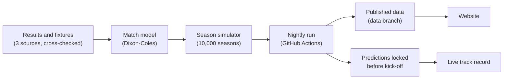

# TableTalk

[](https://github.com/umarjaved204/TableTalk/actions/workflows/daily-update.yml)

**Football title-race and relegation chances, worked out in the open.** TableTalk
predicts every remaining match in the Premier League, Bundesliga, La Liga, Serie A
and Ligue 1, plays out the rest of each season 10,000 times, and publishes the
chances every night. Every assumption is written down, and every forecast is
checked against what actually happened.

## How it works



1. **A match model** gives each team an attack and a defence rating, learned from
   past results with recent matches counting more. From those it works out the
   chance of every scoreline (the Dixon-Coles model, 1997).
2. **A season simulator** plays the remaining fixtures thousands of times with the
   league's real rules: points, tiebreakers, play-offs, points deductions. Counting
   how often each team finishes where gives the title, top-four and relegation
   chances.
3. **A nightly run** fetches the latest results, refits, re-simulates and publishes.
   The last prediction made before each kick-off is locked in an append-only log,
   then scored once the result is in.

Each league is a config file, not new code: the Python only knows *kinds* of rules.
More in [how it works](docs/how-it-works.md).

## Does it work?

Backtested on six seasons the settings were never tuned on (2018-19 and 2021-22 to
2025-26):

- It **beats knowing nothing** (the long-run home/draw/away rates) in every league,
  by 6-10% in log loss.
- Its probabilities are **calibrated**: when it says 40%, it happens about 40% of the
  time.
- It **closes 77-85% of the gap to the betting market**'s closing odds, and the
  market is still a little better. Bookmakers know things it never sees: team news,
  line-ups, injuries.

<picture>
  <source media="(prefers-color-scheme: dark)" srcset="reports/figures/match-calibration-dark.png">
  
</picture>

## Phase 2: the five leagues side by side

Report seasons (2018-19, 2021-22 to 2025-26), Premier League settings everywhere
(half-life, ridge sd and promoted-team strategy were not re-tuned per league).

| | Premier League | Bundesliga | La Liga | Serie A | Ligue 1 |
|---|---|---|---|---|---|
| matches | 2,280 | 1,836 | 2,280 | 2,280 | 2,058 |
| log loss vs base rates | −9.4% | −7.5% | −7.6% | −9.6% | −6.4% |
| share of the gap to the market closed | 83% | 81% | 83% | 85% | 77% |
| model minus market, log loss | 0.020 ± 0.007 | 0.019 ± 0.008 | 0.016 ± 0.007 | 0.018 ± 0.007 | 0.020 ± 0.007 |
| match calibration gap, home / draw / away (pts) | 3.0 / 1.2 / 1.9 | 3.2 / 1.2 / 2.4 | 3.0 / 2.1 / 3.0 | 1.9 / 2.7 / 3.1 | 1.2 / 0.7 / 2.1 |
| season-level calibration gap (pts) | 1.3 | 1.2 | 1.0 | 1.6 | 1.1 |
| home advantage (current fit) | +0.17 | +0.22 | +0.29 | +0.11 | +0.20 |
| official final tables matched, 2010-11 to 2025-26 | 16 of 16 | 16 of 16 | 16 of 16 | 16 of 16 | 16 of 16 |

Across all five, the model closes 77-85% of the gap between knowing nothing and
the closing odds, and trails the market by about 0.02 in log loss. In every league
the promoted-team strategies are within noise of each other on the report seasons,
so `prior` is kept as the single default.

The home-advantage figures are the current fit's, a log-scale multiplier on the
home side's goals within that league. **Team ratings must not be compared across
leagues**: each league is fitted separately, so a rating is relative to that
league's own average, and nothing puts two leagues on one scale (a Phase 3
problem).

How each number was produced, and what is still wrong: [results](docs/results.md).

## The live track record

Backtests can flatter a model, so since 29 September 2026 every prediction is also
scored live. The nightly run locks the last forecast made before each kick-off in
a hash-chained, append-only log on the `data` branch, whose history is protected,
and scores it once the result is in, against the base rates and the betting
market. Current standing:
[track_record/report.md](https://github.com/umarjaved204/TableTalk/blob/data/track_record/report.md).
How the locking works: [the daily update](docs/daily-update.md).

## Quick start

Python 3.10 or newer.

```
git clone --single-branch --branch main https://github.com/umarjaved204/TableTalk.git
cd TableTalk
pip install -e ".[dev]"

python -m tabletalk competitions                                  # the configured leagues
python -m tabletalk simulate --competition premier_league         # title / top-four / relegation chances
python -m tabletalk simulate --competition premier_league --table # projected final table
python -m tabletalk ratings  --competition premier_league         # team ratings and next fixtures
python -m tabletalk evaluate --competition premier_league         # match-level backtest
```

Every command and the repository layout: [development](docs/development.md). The
notebooks [premier_league_results.ipynb](notebooks/premier_league_results.ipynb) and
[phase2_leagues.ipynb](notebooks/phase2_leagues.ipynb) put the predictions,
ratings, backtests and charts in one place.

## Where the project is

| Part | Status |
|---|---|
| Match model, season simulator, backtests (Premier League) | ✅ done |
| Bundesliga, La Liga, Serie A, Ligue 1 (every official final table since 2010-11 reproduced) | ✅ done |
| Nightly update, published data, locked predictions, live track record | ✅ running since 29 Sep 2026 |
| Security hardening (exact library versions, split publish job, checked caches) | ✅ done |
| Website (built and tested, all five leagues, team pages) | built, not live yet |
| European competitions | deferred until the domestic leagues are validated |

## Limitations, in short

- **It only knows results**: no injuries, transfers, line-ups or managerial changes.
- **It trails the betting market** by about 0.02 in log loss, for the same reason.
- **Ratings lag a team that changes suddenly**, and late in a season it is slightly
  under-confident.
- **It cannot pick out likely draws**: draw chances are calibrated but nearly all
  sit between 20% and 30%.
- **Ratings are not comparable across leagues**: each league is fitted on its own.

The full list, and what comes next: [limitations and roadmap](docs/limitations.md).

## Read more

| Page | What is in it |
|---|---|
| [How it works](docs/how-it-works.md) | The three-layer design, the match model in plain English, the season simulator, tiebreakers, rating uncertainty |
| [Results](docs/results.md) | How the settings were chosen, calibration, season forecasts, the betting market, promoted teams, what is still wrong |
| [Leagues, rules and data](docs/leagues.md) | Data sources, each league's rules (verified and assumed), points deductions, adding a league |
| [The daily update](docs/daily-update.md) | The nightly run, published files, locking before kick-off, the track record, safety checks |
| [Development](docs/development.md) | Getting the code, repository layout, tests |
| [Limitations and roadmap](docs/limitations.md) | Everything the model does not know, and what is next |
| [Data contract](contracts/README.md) | Every field of the published files, for anyone building on them |
