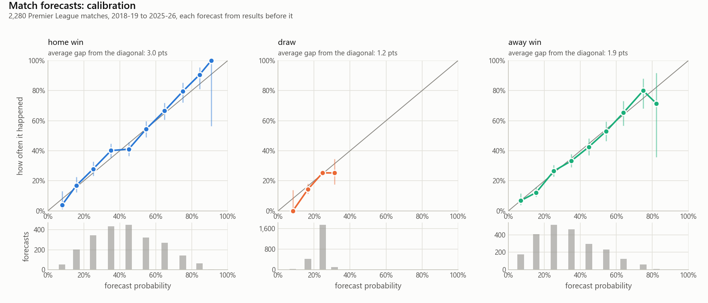
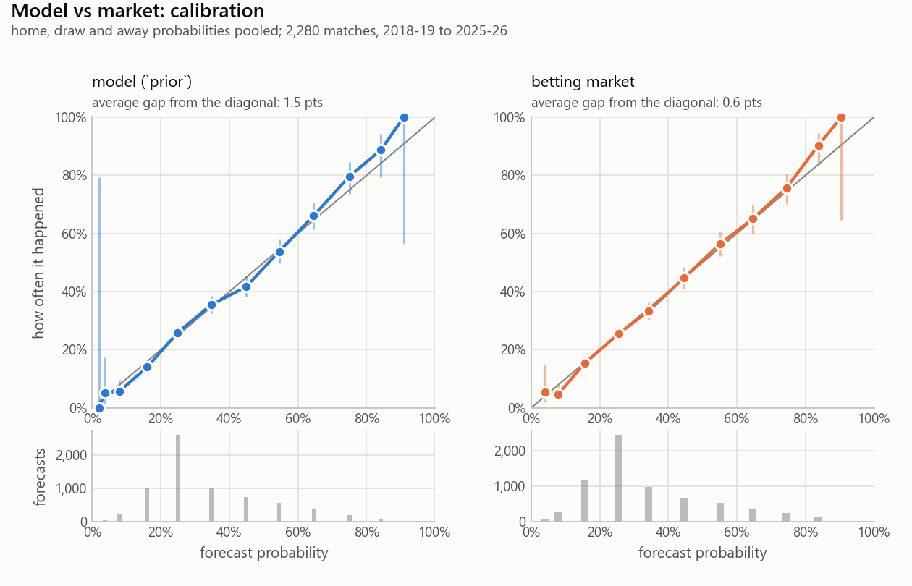
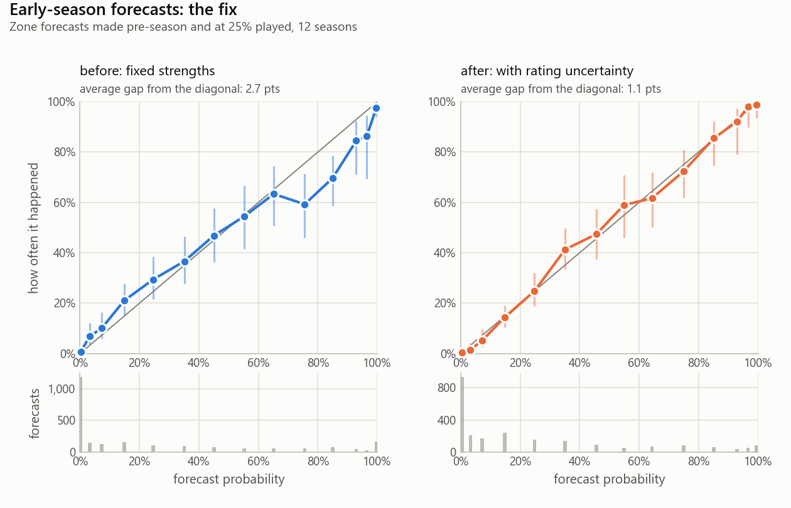
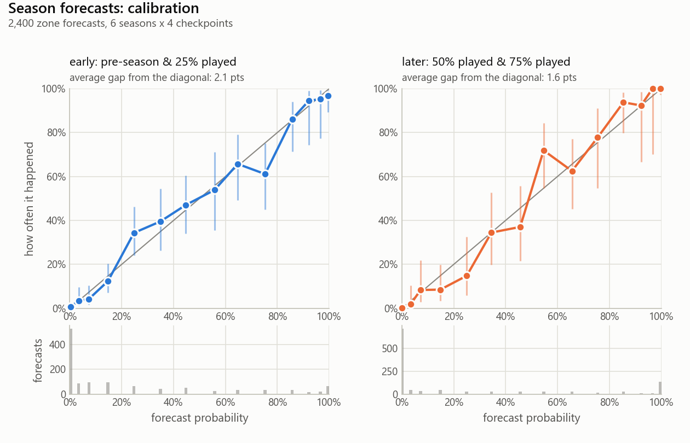

# Results

Does it work? The model is checked against what actually happened: is the implementation right, does it beat simple baselines, are its probabilities calibrated, and how close does it get to the betting market. All five leagues side by side are in the [README](../README.md#phase-2-the-five-leagues-side-by-side).

Contents:

- [The match model: validation](#the-match-model-validation)
- [Results: does it work?](#results-does-it-work)

[Back to the README](../README.md)

## The match model: validation

### Is the implementation right?

Before asking whether the model is *good*, check that it is *correct*:

- **The gradient matches finite differences** to about 1e-7 relative error. The
  optimiser uses a hand-derived gradient; an almost-right gradient still converges,
  just to the wrong place, so this is the first check.
- **Parameter recovery.** Simulate 11,200 matches from known ratings using the exact
  Dixon-Coles score distribution, fit the model, and confirm it gets the ratings,
  home advantage and rho back within sampling error. This is what catches a flipped
  sign on defence or a tau correction applied to the wrong scoreline.

### Does it beat knowing nothing?

`python -m tabletalk evaluate` runs a **rolling-origin backtest**: for each week of
a completed season, fit using only results before that week, forecast the week's
matches, move on. No forecast ever sees a result from its own future. Every model
is compared with a **baseline** that ignores the teams and predicts the league's
historical home/draw/away frequencies.

Scores are *proper scoring rules* (lower is better): **log loss**, **Brier score**,
and **ranked probability score**, which respects that a draw is "closer" to a home
win than an away win is.

The headline covers the **6 report seasons: 2018-19 and 2021-22 to 2025-26, 2,280
matches**. The model's settings were chosen on the six seasons before them, never
on these (see [how the settings were chosen](#how-the-settings-were-chosen)). The two
COVID-affected seasons are left out of both halves; that exclusion was decided and
written into the config, with the reason, before any backtest was run.

| report seasons | log loss | vs baseline |
|---|---|---|
| Dixon-Coles | **0.965** | **−9.4% log loss** |
| Base rates | 1.064 | — |

Phase 1 originally reported 0.968 (−9.2%) over all 12 seasons, 2012-13 to
2025-26. That figure is partly in-sample, because the promoted-team strategy and
the simulation settings were chosen on the same seasons; the report-season figure
is the one to quote. The per-season and COVID results below are from the Phase 1
run over every season.

The model beats the baseline in **all 14 seasons tested**, the COVID ones included.
Its worst season is 2015-16 (log loss 1.035 against the baseline's 1.088): the
season Leicester won the league as 5000-1 outsiders. A model built on "strength
drifts slowly" should find that season hardest, and it does.

**The COVID seasons on their own** (2019-20 and 2020-21, 760 matches): still 7.2%
better than the baseline, despite 2020-21 being played without crowds.

### What the data says about the parameters

Fitting each season on its own shows how much the "fixed" parameters actually move:

- **Home advantage** averages +0.24 in normal seasons (home sides score ×1.27), with
  a standard deviation of 0.07 between seasons. In 2020-21, behind closed doors, it
  was **+0.007**, essentially zero, and that was the only season in the data with
  more away wins than home wins. It has also **declined**, from about +0.27 in the
  early 2010s to about +0.18 recently, and even with crowds 2024-25 came in at
  +0.06. Time decay lets the current estimate (+0.17) follow that drift.
- **rho** is noisy: per season it ranges from −0.16 to +0.14, averaging −0.045. It
  only reshapes four scorelines, so it needs a lot of data; simulations show the
  same (from 2,240 simulated matches with a true rho of −0.10, fitted values ranged
  from −0.02 to −0.14). The current fit's −0.08 comes from about 520
  effective matches and is probably overstated.
- **Time decay** is now **365 days**, chosen on the tuning seasons only (below).
  Log loss is flat from 270 to 540 days and clearly worse below 120. Phase 1 used
  180 days, a round number picked a priori and later only *checked* on 2023-24 to
  2025-26, so its survival was not independent of the test seasons.
- Matches whose decay weight falls below 0.001 (at 365 days, more than ~10 years
  old) are left out of each fit. It is a speed setting, verified rather than tuned:
  on the 330 remaining 2026-27 fixtures it drops 2,350 old matches and moves no
  win, draw or loss probability by more than 0.0004.

### Promoted teams

A team promoted this season has few or no recent Premier League results. Fitted
naively, it is rated on a handful of matches: with five games played, the
unadjusted model puts newly promoted Hull City **5th in the league** on the
strength of two wins.

How public models handle this: nearly all of them (Elo-style systems,
FiveThirtyEight's SPI, Opta's power rankings) sidestep it by rating more than one
division on a single scale, so a promoted team arrives with a rating earned below.
Dixon and Coles' own paper fitted league and cup data across English divisions.
Academic goal models more often shrink sparse teams toward a common prior.
TableTalk implements both and lets the backtest decide:

- **`prior`**: start each promoted team at the average first-season rating of the
  45 teams promoted in the previous 15 seasons (they scored ×0.77 and conceded
  ×1.21 an average team's goals), with a spread equal to how much those teams
  varied. Their own results then pull them away from it.
- **`second_tier`**: fit the Championship alongside the Premier League, with its
  own goal-rate offset, so promoted teams carry a Championship-earned rating onto
  the Premier League scale via the clubs that move between divisions.
- **`none`**: no special handling, as a reference point.

Phase 1 compared them over all 12 seasons (36 promoted teams, 180-day half-life);
the clean re-run on the report seasons follows below.

| matches | n | `none` | `prior` | `second_tier` |
|---|---|---|---|---|
| all | 4,560 | 0.972 | **0.968** | 0.970 |
| promoted team involved | 1,296 | 0.932 | **0.917** | 0.930 |
| early season (games 1-10), promoted team involved | 340 | 0.930 | **0.904** | 0.932 |

Paired comparisons on the same matches (95% intervals, so "± x" is about two
standard errors):

- `prior` minus `none`: −0.0042 ± 0.0026 overall, −0.0146 ± 0.0093 on
  promoted-team matches.
- `prior` minus `second_tier`: −0.0129 ± 0.0073 on promoted-team matches,
  −0.028 ± 0.020 in the first ten games.
- `second_tier` minus `none`: indistinguishable from zero.

These are in-sample (the strategy was chosen on the same seasons) and small: about
1.5% of the log loss on the matches concerned.

Bias in forecast goal difference for promoted teams (forecast minus actual, goals
per game, from the promoted team's side):

| | games 1-10 | games 11-38 |
|---|---|---|
| `none` | +0.23 ± 0.17 | −0.03 ± 0.10 |
| `prior` | **+0.15 ± 0.16** | −0.04 ± 0.10 |
| `second_tier` | +0.39 ± 0.17 | +0.08 ± 0.10 |

**Why the Championship approach does worse: the winner's curse.** A club is promoted
partly *because* its Championship results flattered it, so a rating built from
those results is biased upward. The clubs `second_tier` got most wrong were the
ones that ran away with the division: Burnley 2023-24 (forecast −0.39 goals per
game in their first ten matches, actual −1.7), Burnley and Leeds 2025-26.
Multi-division rating systems have to correct for exactly this; the `prior`
approach avoids it because it is measured on promoted teams' actual Premier
League results.

**Clean re-run.** Chosen again on the tuning seasons alone (2012-13 to 2017-18, 18
promoted teams), `prior` had the lowest log loss on promoted-team matches:

| tuning seasons, promoted team involved (648 matches) | log loss | `prior` minus it |
|---|---|---|
| `prior` | **0.938** | |
| `second_tier` | 0.948 | −0.0097 ± 0.0103 |
| `none` | 0.961 | −0.0224 ± 0.0108 |

Then scored once on the report seasons (2018-19, 2021-22 to 2025-26, 18 promoted
teams), with the settings fixed:

| report seasons, `prior` minus ... (95% intervals) | promoted team involved (648) | first ten games, promoted team (169) |
|---|---|---|
| `none` | −0.0020 ± 0.0122 | +0.0032 ± 0.0357 |
| `second_tier` | −0.0161 ± 0.0101 | −0.0315 ± 0.0244 |

**Decision: `prior`. It is consistently better but modest**, against both
alternatives:

| `prior` minus ..., promoted-team matches | tuning seasons | report seasons | seasons where `prior` did better |
|---|---|---|---|
| `none` | −0.0224 ± 0.0108 | −0.0020 ± 0.0122 | 10 of 12 |
| `second_tier` | −0.0097 ± 0.0103 | −0.0161 ± 0.0101 | 10 of 12 |

It comes out ahead in 10 of the 12 seasons against each, which is the
"consistently"; but the margins are small, and each comparison is inside the
noise in one of the two halves (against `none` on the report seasons, against
`second_tier` on the tuning seasons), which is the "modest". It should not be
described as beating either. With the 365-day half-life an unprotected promoted
team starts nearer where it should anyway, so there is less for the prior to fix.
Eighteen promoted teams per half is not many.

A lesson in statistical power along the way: an earlier version of this backtest
covered only three seasons (nine promoted teams) and could not separate `prior`
from `none` at all (a difference of −0.0005 ± 0.019). Loading 2010-11 onwards
quadrupled the sample and turned "no detectable difference" into a consistent,
if modest, one. With nine teams, the honest conclusion was "we cannot tell", not
"it doesn't matter".

Open questions, deliberately not tuned against the same test seasons:

- **Promoted teams are getting weaker.** Their average first-season net rating
  fell from −0.38 (2011-12 to 2017-18) to −0.53 (2018-19 to 2025-26), consistent
  with the widely reported gap between the Premier League and the Championship
  growing. A prior weighting recent seasons more heavily would track that; it
  likely explains the remaining +0.15 early-season bias.
- **A corrected `second_tier`**, shrinking Championship ratings toward the promoted
  prior, might combine team-specific information with the winner's-curse
  correction.
- **Squad value** (e.g. Transfermarkt) is the one signal that separates a
  well-funded promoted team from a weak one before either plays; it needs a new
  data source.

## Results: does it work?

Two backtests. The headline figures are from the **6 report seasons** (2018-19,
2021-22 to 2025-26), with every setting chosen beforehand on the 6 tuning seasons
(2012-13 to 2017-18). The two COVID-affected seasons are left out of both, a
decision recorded in the config before any results were seen. Everything below is
in [the results notebook](../notebooks/premier_league_results.ipynb), or reproduce it
with `python -m tabletalk evaluate`, `evaluate-seasons` and `benchmark` (all
default to `--split report`).

**How results are worded.** Comparisons are paired (both forecasts scored on the
same matches) and quoted as a difference ± a 95% interval, which is about two
standard errors. When that interval includes zero, or a result holds in one half of
the data but not the other, it is described as "consistently better but modest"
(if it points the same way in most seasons) or "no detectable difference", never
as "beats". Season-level cells have no intervals (six seasons are too few to
estimate one per cell), so they are described, not declared won.

### How the settings were chosen

A setting chosen by scoring it on the seasons you then report makes the results
look better than they will be on new seasons. Phase 1 had that problem in part:
the promoted-team strategy and the simulation settings were picked on the same 12
seasons the results were quoted on, and the half-life had been checked on three of
them. There was no *data* leak (every forecast used only earlier results, and the
promoted-team prior only earlier seasons, which a test now checks by deleting every
later season and getting an identical prior). The leak was in the *choices*.

So the completed seasons are split in time (`evaluation.split` in the config).
The split and the decision rules were written down before anything was run
([protocol](../reports/protocols/a1-clean-split.md)):

| setting | how it was chosen | rule, on the tuning seasons | result |
|---|---|---|---|
| half-life | grid 60 to 540 days | lowest log loss | **365 days** (was 180) |
| ridge prior sd | grid 0.5, 1, 2 (jointly with the half-life) | lowest log loss | **1.0** (unchanged) |
| weight cutoff | a speed setting: verified, not tuned | no probability moves by 0.001 | **0.001** (unchanged) |
| promoted teams | `none` / `prior` / `second_tier` | lowest log loss on promoted-team matches | **`prior`** (unchanged) |
| simulation | fixed / rating uncertainty / + drift | lowest pooled zone log loss | **rating uncertainty** (unchanged) |

`python -m tabletalk tune` reruns the grid. Two honest caveats. The report seasons
are not "never seen": Phase 1 quoted numbers on them. What the split guarantees is
narrower: nothing was chosen using them. And the half-life change itself is
invisible out of sample: on the report seasons the 365-day model scores +0.0006 ±
0.0033 log loss against the 180-day one, i.e. no difference.

**What changed in the headline numbers** (report seasons unless stated):

| | Phase 1 (all 12 seasons) | clean split (report seasons) |
|---|---|---|
| match log loss vs baseline | −9.2% | −9.4% |
| match calibration gap, home / draw / away (pts) | 1.6 / 0.9 / 1.4 | **3.0** / 1.2 / 1.9 |
| season zone log loss, pooled | 0.1890 | 0.1873 |
| season calibration gap, early / later (pts) | 1.1 / 1.6 | **2.1** / 1.5 |
| relegation at 75% played, vs "table as it stands" | −28.5%\* | +22.5% |
| `prior` vs `none`, promoted-team matches | −0.0146 ± 0.0093 | **−0.0020 ± 0.0122** |

The calibration gaps are wider partly because each bin now holds half as many
matches (the home-win bins that miss are mostly still inside their 95% intervals).

\* Both Phase 1 numbers and the first clean-split run (−43.5%) built tables
without points deductions, so in 2023-24 the "table as it stands" was not the table
that was actually standing. See [points deductions](leagues.md#points-deductions): with the
real table, the naive baseline gets 2023-24 wrong and the model is ahead on this
cell. The season-level numbers here are from the corrected run; match-level ones
are unaffected, since a deduction changes no match result.

### Match forecasts are well calibrated

Every match was forecast from a fit using only earlier results. Grouping the
forecasts by the probability they gave:

<picture>
  <source media="(prefers-color-scheme: dark)" srcset="../reports/figures/match-calibration-dark.png">
  
</picture>

When the model gave the home side 60-70%, the home side won **66.5%** of the
time (95% interval 60.7-71.9%). Across all bins the average gap from the diagonal
is 3.0 percentage points for home wins, 1.2 for draws and 1.9 for away wins; the
home-win gap comes mostly from the 30-40% and 40-50% bins, which miss in opposite
directions. Overall log loss is **9.4% better than the base-rate baseline** (0.965
against 1.064).

The one thing it cannot do is **pick out draws**. Its draw forecasts are well
calibrated but barely vary: 1,740 of 2,280 fall between 20% and 30%, and none go
above 36%. Team strengths say who is likely to win, much less whether a match will
finish level. This is a known property of Dixon-Coles.

### Season forecasts are ahead of both baselines

Each season was replayed from four checkpoints (pre-season, then after 25%, 50%
and 75% of the matches), simulated 5,000 times from what was known at that
point, and scored against the real final table. Brier-score skill, as % better
than each baseline:

| vs **uniform** (knows nothing) | title | top four | top five | top half | relegation |
|---|---|---|---|---|---|
| pre-season | 54.4 | 43.7 | 56.0 | 34.9 | 29.3 |
| 25% played | 66.6 | 57.4 | 66.4 | 50.5 | 54.8 |
| 50% played | 65.8 | 77.9 | 85.3 | 65.7 | 65.9 |
| 75% played | 67.4 | 76.8 | 85.3 | 70.3 | 79.7 |

| vs **persistence** (the table as it stands) | title | top four | top five | top half | relegation |
|---|---|---|---|---|---|
| pre-season | 35.0 | 46.0 | 55.0 | 42.6 | 22.8 |
| 25% played | 76.2 | 54.5 | 52.8 | 32.5 | 30.9 |
| 50% played | 67.5 | 29.2 | 58.6 | 14.1 | 34.9 |
| 75% played | 69.0 | 44.3 | 58.6 | 44.3 | 22.5 |

(Six seasons, so six titles and 18 relegations: single cells move a lot with one
season's surprises. The relegation cell at 75% shows how much: it rests on two
seasons, 2022-23, where the model lost, and 2023-24, where the table was misleading.)

"Persistence" is the naive pundit: the final table will look like the current
one (pre-season, last season's table with the promoted teams at the bottom). The
model is ahead of it in every cell, by margins that range from large (the title,
top five) to one season's worth (relegation at 75% played, discussed below). Finishing positions
tell the same story: the expected position is 3.0 places off pre-season
(persistence: 3.2), falling to 1.3 with a quarter of the season left
(persistence: 1.4).

### How close does it get to the betting market?

Bookmakers' closing odds are the strongest public forecast of a match: they pool
every model and tipster and all the team news up to kick-off. They are the ceiling
to measure against, not something to claim to beat. `python -m tabletalk benchmark`
compares the model with them on exactly the same matches.

**Which odds.** football-data.co.uk publishes several bookmakers. The preference is
**Pinnacle's closing odds** (low margin, and closing prices absorb all pre-match
news), available for every Premier League season from 2012-13, but only up to 8
January 2026. For the rest of 2025-26 (170 matches) the fallback is the **average
closing odds across bookmakers**: same timing, wider margin (about 5.7% against
Pinnacle's 2-3%). The preference order is set in the config (`odds_preference`),
and every report-season match is covered:

| season | matches | Pinnacle closing | market average (fallback) | average margin |
|---|---|---|---|---|
| 2018-19 to 2024-25 (5 seasons) | 1,900 | 1,900 | 0 | 2.4-3.0% |
| 2025-26 | 380 | 210 | 170 | 4.3% |

**From odds to probabilities.** Odds of 2.50 "imply" 1 / 2.50 = 40%. Across home,
draw and away these add up to a little over 100%; the excess is the bookmaker's
margin. Dividing each by the total makes them sum to one (**proportional
normalisation**). *Assumption:* this spreads the margin evenly, whereas bookmakers
put more of it on long shots, so outsiders come out slightly too likely. With
Pinnacle's small margin the effect is about a point at most.

**Result (report seasons, 2,280 matches):**

| | log loss | Brier | RPS |
|---|---|---|---|
| knows nothing (base rates) | 1.064 | 0.644 | 0.233 |
| model | 0.965 | 0.573 | 0.199 |
| market | **0.945** | **0.559** | **0.192** |

The model closes **83% of the gap** between knowing nothing and the market. The
market is better by 0.020 ± 0.007 in log loss (paired, 95% interval), and by the
same on the Pinnacle-only matches (0.019 ± 0.007), so the fallback odds do not
change the picture. Per season the model closes between 59% and 95% of the gap:

| season | model minus market | gap closed |
|---|---|---|
| 2018-19 | 0.007 | 95% |
| 2021-22 | 0.013 | 90% |
| 2022-23 | 0.036 | 59% |
| 2023-24 | 0.024 | 84% |
| 2024-25 | 0.022 | 81% |
| 2025-26 | 0.017 | 76% |

2022-23 is the outlier, the season of Arsenal's unexpected title challenge and
Chelsea's and Leicester's collapses: fast changes in strength, which the market
sees and ratings built on a year-long memory catch late. On the tuning seasons
(2012-13 to 2017-18) the model closed 87% of the gap.

<picture>
  <source media="(prefers-color-scheme: dark)" srcset="../reports/figures/market-calibration-dark.png">
  
</picture>

**Calibration.** Both are well calibrated; the market a little more so (average gap
from the diagonal, home / draw / away: model 3.0 / 1.2 / 1.9 points, market 2.0 /
1.3 / 1.1). The market's edge is mostly *sharpness*: it separates teams more
precisely, not more honestly.

**Draws are hard for everyone.** The market's draw forecasts barely vary either
(standard deviation 5.3 points, against the model's 4.5; 73% of its draw forecasts
fall between 20% and 30%). "It cannot pick out draws" is mostly a property of
football, not a flaw peculiar to Dixon-Coles.

**What the gap is made of.** Closing odds know line-ups, injuries, suspensions and
managerial changes; the model sees only results, from a fit up to a week old. Part
of the gap is information the model is never given, not modelling error.

### Fixing the early over-confidence

(Phase 1 history, over all 12 seasons and with the 180-day half-life. The same
choice was later re-made on the tuning seasons alone and came out the same; see
[how the settings were chosen](#how-the-settings-were-chosen).)

The first version simulated every season with fixed, best-estimate strengths.
Its backtest found that **forecasts made early in a season were over-confident**:
when it said 70-99% pre-season, the outcome happened 71% of the time against an
average forecast of 87%, about 3.5 standard errors off. Its pre-season title
favourite was given 58% on average and won 5 of 12 titles (42%).

The cause is the fixed strengths: they ignore how uncertain each rating is, and
that uncertainty is shared by all of a team's remaining matches. Three versions
were run through the same backtest, with the decision rule written down
beforehand (improve overall accuracy, fix the early over-confidence, don't hurt
later calibration):

| | fixed strengths | + rating uncertainty | + drift as well |
|---|---|---|---|
| zone log loss, pooled (lower is better) | 0.1949 | **0.1890** | 0.1895 |
| confident (70-99%) pre-season forecasts: forecast / observed | 86.6% / 71.4% | 86.0% / **83.3%** | 86.4% / 84.9% |
| calibration gap, early season | 2.7 pts | **1.1 pts** | 1.3 pts |
| calibration gap, later season | **1.0 pts** | 1.6 pts | 1.6 pts |
| pre-season favourite's average title chance (won 42% of the time) | 58% | **46.5%** | 44% |

<picture>
  <source media="(prefers-color-scheme: dark)" srcset="../reports/figures/uncertainty-fix-dark.png">
  
</picture>

**Adopted: rating uncertainty, without drift.** Strictly, it misses the third
condition: forecasts made mid-to-late season become slightly *under*-confident
(the later-season gap rises from 1.0 to 1.6 points). Weighed against sampling
error, the trade is lopsided: the early-season miss was about 3.5 standard errors
and is now inside one; the new later-season miss is inside the noise at 50%
played and about two standard errors at 75%, where the fixed version was already
under-confident. Drift added nothing on any pooled measure, so it stays off.

<picture>
  <source media="(prefers-color-scheme: dark)" srcset="../reports/figures/season-calibration-dark.png">
  
</picture>

### What is still wrong

- **Late in a season, it hedges where the table has already decided.** With a
  quarter of the season left, the bottom three stayed there in 4 of the 6 report
  seasons. In those, "the table as it stands" is perfect and the model, holding on
  to ratings, can only be worse: Leicester 2022-23 were in the bottom three and
  given a 20% relegation chance (they went down). Pooled over the six seasons the
  model is now ahead (+22.5%), but only because the naive table got 2023-24 wrong
  (Nottingham Forest were in the bottom three after their deduction and survived).
  Phase 1's apparent weakness (−28.5%, and −43.5% in the first clean-split run)
  was partly an artefact of tables built without deductions. The underlying
  problem is still there: this is lag, not width: ratings built partly from
  last season are slow to catch a genuinely declining team, and uncertainty does
  not fix that. A model where strength changes explicitly over time, rather than
  one half-life doing two jobs, is the principled next step.
- **Mid-to-late forecasts are now slightly under-confident** (the gentle S-shape
  above). One reading: in-season uncertainty is overstated while the change
  between seasons is understated, so modelling the summer (transfers,
  pre-season) separately from in-season drift could fix both ends at once.
- **Sample size.** Twelve seasons means twelve champions and 36 relegated teams,
  so the rare-event numbers carry real uncertainty; and pooled season-level
  observations are not independent (the same team appears at four checkpoints,
  and exactly one team wins each title), so the calibration intervals are
  narrower than they should be.
